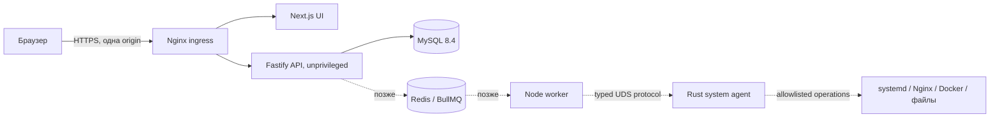

# Minfinite Infrastructure — handoff проекта

> Восьмое продолжение22.11.2026: пользователь явно потребовал скопировать все настройки New Site из живого ISPmanager. Сверены полный field inventory и варианты redirect/subdomains/charset/rotation/cache/report generator без сохранения формы на хостинге. Добавлен реальный SiteSettingsFields для всех групп: Сайт, Дополнительные возможности, Журналы, Оптимизация; действующий HTML editor сохранён. Отсутствующие host функции показаны disabled с объяснением и не попадают в mutation payload. Подготовлен **proposed**, не утверждённый [site-settings-v2](architecture/site-settings-v2.md) с threat model/contracts/tests для расширения. PHP/TLS/CGI/log rotation/AWStats не установлены этим UI переносом; нельзя считать задачу функционального подключения всех полей завершённой. Согласование новых host operations ещё требуется по исходному условию пользователя.

> Седьмое продолжение22.11.2026: по запросу пользователя изучена живая страница ISPmanager Sites (создание, редактирование, действия, фильтры; без сохранения изменений на хостинге). Разделы Minfinite получили общий WorkloadInventory: toolbar, отдельные slate rows, выбор одного ресурса, фильтры состояния/обработчика, сортировка, search clear, сведения/actions dialog и site switch. Create/edit вынесены в отдельную grouped form с dirty discard guard. Рабочие функции прежнего согласованного API сохранены; PHP/siteTLS/files/backups не становятся реализованными из-за наличия похожих элементов в ISPmanager.8 Chromium scenarios, web build/typechecks и static audit прошли. См. [design QA](design-qa.md). Архитектура, API contracts, агент и данные не менялись этим UI increment.

> Шестое продолжение 22 ноября 2026: после явного согласования [managed-workloads-v1](architecture/managed-workloads-v1.md) реализованы и установлены **Сайты, Контейнеры и MySQL**. Static HTTP create/edit/disable/enable, reverse proxy на собственный Nginx, Nginx/Redis create/start/stop и отдельные MySQL8.4 с app user и сохранением данных работают через owner-only API, MySQL outbox, BullMQ worker uid10002 и подписанный Rust UDS root-agent. API/worker без Docker socket; только API имеет admission private key. MySQL/Redis публикуются только на loopback20000–20199, credentials выдаются после currentPassword. Панель остаётся на **https://185.47.142.141:8443**. Локально прошли161 API tests,18 isolated MySQL tests,7 Chromium scenarios; Linux agent build/tests и реальная серверная приёмка подтвердили HTTP, Redis AUTH, MySQL app grants/data persistence и recovery. Подробности эксплуатации и границ — [workloads runbook](operations/workloads.md). Generic Server/ResourceGrant/diagnostic/cancel, PHP, site TLS, произвольный Compose, файлы, terminal, deletion и backups не реализованы этим выпуском. Ниже — исторические снимки, их отрицания agent/worker/sites больше не описывают текущий код.

> Пятое продолжение 22 ноября 2026: пользователь сохранил архитектуру Minfinite, предоставил Ubuntu-сервер и согласовал [границы установки, threat model и приёмочные проверки](operations/ip-deployment.md). Установлена отдельная тестовая панель **https://185.47.142.141:8443**; 443 для сайтов, 80 только ACME. Доверенный короткоживущий IP-сертификат выдан до 29.11.2026 01:09:19 UTC; renewal dry-run успешен, timer включён. API/web работают под uid10001/10003, read-only и без capabilities; собственные MySQL/Redis на loopback13306/16379. Существующий 1Panel MySQL на loopback3306 сохранён. На сервере проверены owner login, точный Origin с портом, cookies, CSRF/logout, отказ `test`, повтор migrations/bootstrap и отказ/восстановление собственной DB. Новый slate UI: sidebar, рабочие разделы и реальный audit journal с поиском/пагинацией. 156 API tests и четыре Chromium-сценария прошли. Сайты/файлы/worker/agent по-прежнему не реализованы; эта установка не означает «Готово» всей панели. Исходные proposed системные спецификации не считаются согласованными этим разрешением на base deployment.

> Четвёртое продолжение 22 ноября 2026: добавлены [production config gates](operations/production-config.md), bounded DB timeouts и безопасные configuration errors. API отказывается от внешнего bind/HTTP origin/root runtime/миграционного секрета; `pnpm config:check` проверяет без соединения с БД. [Локальная auth restore finalization](operations/auth-restore.md) требует offline maintenance и точное подтверждение схемы, отзывает sessions/pending enrollments/исторические recovery codes, блокирует старое TOTP окно, сохраняет активные TOTP secrets и атомарно пишет audit. Реальный mysqldump/import, grants outage, killed connections, stalled handshake и restore rollback проверяются на owned disposable MySQL. Suite: 156 API/unit/config/contract/safety tests и 15 MySQL tests; production/host/crash/disk-full/off-host recovery всё ещё не доказаны. Рабочая БД не менялась, системные спецификации не согласованы и агент не реализован.

> Третье продолжение 22 ноября 2026: добавлен полностью изолированный MySQL runner и 10 реальных migration/RBAC/bootstrap/concurrency/rollback tests; все прошли на MySQL 8.4.13. Исправлен bootstrap mutex: owner-role row lock теперь держится до COMMIT, вместо RELEASE_LOCK внутри незавершённой транзакции. Добавлены [OpenAPI 3.1](api/openapi.json) всех 12 текущих операций и runtime response schemas из одного источника; users/audit pagination унифицирована. Unit/API/contract suite — 121/121. См. [запуск MySQL suite](testing/mysql-integration.md) и [контракты API](api/README.md). Рабочая БД и системные службы не менялись; тестовый MySQL остановлен, owned temporary data удалены. Следом — production config gates и failure/recovery проверки; системный агент/worker отсутствуют, proposed системные спецификации не считаются согласованными.

> Второе продолжение 22 ноября 2026: реализована [auth security policy](architecture/auth-security-policy.md). Настройка/подтверждение/отключение 2FA требуют currentPassword; включение/отключение отзывают остальные сессии, текущая остаётся для сохранения recovery-кодов. Вход и изменения auth сериализуются per-user SELECT FOR UPDATE с повторной проверкой состояния. Смена пароля завершает все сессии и удаляет pending enrollment. UI обновлён вместе с body contracts. Проверены 104 API/unit tests на fake DB и три Chromium UI tests на синтетических ответах; это не доказательство реальной MySQL concurrency. Следующая работа — isolated MySQL migration/bootstrap/auth/concurrency tests и OpenAPI. Спецификации системного этапа остаются proposed, системный агент не реализовывался.

> Продолжение от 22 ноября 2026 (Europe/Moscow): выполнен первый проверяемый auth increment — CSRF user creation, strict audit query, фактическое подключение rate-limit hooks, безопасные ошибки/логи, request IDs и no-store. Добавлено 85 API/unit tests без рабочей БД; tests, typecheck API/web и typecheck тестов прошли на Node 24.22.3/pnpm 11.25.0 после frozen-lockfile установки. Подробности и оставшиеся задачи — в [обновлённой сверке](architecture/repository-state.md). Следующий этап: full auth flows/reauth/session revocation, изолированные MySQL integration tests и OpenAPI. Миграции/рабочая БД не менялись, системный этап не начинался, proposed спецификации не считаются согласованными.

> Продолжение от 21 ноября 2026 (Europe/Moscow): выполнена [сверка исходников](architecture/repository-state.md), добавлен [проект спецификации MVP](architecture/README.md). Исходный снимок ниже сохранён как исторический: дата 22 ноября, работающие процессы и успешные проверки не подтверждают текущее состояние. Спецификация имеет статус «предложено для согласования»; runtime-функции и системные операции не добавлены. Следующий этап — воспроизводимые зависимости и auth tests/CSRF/audit validation, затем непривилегированные operations. Перед системным этапом требуется согласование threat model, контрактов и тестов.

> Снимок состояния на 22 ноября 2026 года. Этот файл нужен, чтобы продолжить работу в новом чате или на другом компьютере без потери контекста. Источники истины по поведению — текущий код, `README.md`, `docs/architecture/` и локальная конфигурация, а не старые сообщения чата.

## Кратко

UI седьмого продолжения установлен на Ubuntu: пересоздан только web, API/worker/agent и managed данные сохранены. Внешние HTTPS panel200 и ready/database ok успешны. Browser проверил новый список/фильтры/create/dirty discard; все8 сценариев прошли, после финального focus fix повторены4 workload scenarios. Rollback image: minfinite/web:before-sites-ui. [Матрица ISPmanager→Minfinite](architecture/ispmanager-sites-reference.md) отделяет реализованные функции от следующего системного расширения.

Актуальный контрольный результат шестого продолжения: финальные build/boundary/сквозная приёмка и3 recovery сценария прошли;7 собственных fixtures архивированы с сохранением данных/журнала, рабочий inventory пуст. Worker и agent включены, pending/running operations нет; HTTPS `/api/health/ready`200, internal endpoint снаружи404; существующий 1Panel MySQL сохранён. Для продолжения читать верхнюю актуализацию и workloads runbook. Следующий функциональный этап требует отдельного контракта: PHP/site TLS либо файлы/backups; не считать это уже реализованным. Описанный далее исходный auth-only срез — история.

Minfinite Infrastructure — задуманная панель управления Linux-серверами уровня ISPmanager/Plesk/CloudPanel. Сейчас создан и запущен первый защищённый вертикальный срез: Next.js UI, Fastify API, MySQL, вход владельца, серверные сессии, RBAC, аудит, настройка 2FA и управление аккаунтами панели. Это ранняя разработка, а не готовая панель для управления production-сервером.

Локальный адрес: <http://localhost:3000/>. API доступен через same-origin proxy веб-приложения и напрямую на `127.0.0.1:3001`. В проверенном экземпляре API отображает состояние «доступен».

В этом вертикальном срезе ранее успешно прошли `pnpm typecheck`, применение начальной Prisma migration, bootstrap RBAC и создание первого owner. Это не заменяет будущие тесты безопасности и восстановления; отдельный test suite пока не добавлен.

## Запуск на текущем компьютере

На момент фиксации состояния слушают локальные порты:

| Порт | Процесс | Назначение |
| --- | --- | --- |
| `127.0.0.1:3000` | Node.js | Next.js UI |
| `127.0.0.1:3001` | Node.js | Fastify API |
| `127.0.0.1:3306` | MySQL (`mysqld`) | База Minfinite |

Запуск выполнен на Windows для локальной проверки. MySQL 8.4.9 установлен из официального пакета Oracle. Каталог данных MySQL на этом компьютере: `%LOCALAPPDATA%\MinfiniteDev\mysql-data`. Node.js: `v24.15.0`; pnpm: `11.25.0`. Владелец в тестовой базе: `admin@example.com`; временный пароль был установлен как `test` по просьбе пользователя. Это слабый пароль только для локального теста. Не публиковать порт и не использовать этот пароль на доступном извне сервере.

Из корня проекта запускать:

```powershell
pnpm dev
```

Команда параллельно поднимает API и веб-приложение. Если порты уже заняты, сначала проверьте существующие процессы — возможно, приложение уже работает. Полезные команды:

```powershell
Get-NetTCPConnection -State Listen -LocalPort 3000,3001,3306
pnpm typecheck
```

Если API или web не стартуют, проверьте локальный MySQL, `.env`-файлы, версию Node/pnpm и сообщения соответствующего процесса. Не публикуйте содержимое `.env` в чат или логи.

## Перенос на другой компьютер

### Что переносить

1. Весь каталог проекта `Minfinite`, включая `apps/`, `docs/`, `package.json`, `pnpm-lock.yaml`, `pnpm-workspace.yaml` и `tsconfig.base.json`.
2. Локальный `apps/api/.env` — только безопасным способом. Он содержит адреса БД, пароли БД и ключ шифрования, поэтому файл игнорируется Git и не должен попадать в публичный архив или репозиторий.
3. Резервную копию базы данных, если требуется сохранить пользователя, роли, аудит, включённую 2FA и другие данные.
4. Ключ `ENCRYPTION_KEY` из `apps/api/.env` при переносе существующей базы. TOTP-секреты зашифрованы этим ключом; без исходного ключа существующая 2FA станет нечитаемой. Сохранить ключ отдельно от дампа базы.

На текущей машине каталог проекта не является Git-репозиторием (`git status` сообщает, что репозиторий не найден). Поэтому для переноса копируйте папку проекта напрямую или сначала отдельно настройте Git. `node_modules`, `.next` и `*.tsbuildinfo` можно не копировать: их создают заново.

### Перенос состояния базы

В текущей сессии дамп базы не создавался. Для сохранения текущего состояния сначала сделайте согласованную резервную копию базы средствами MySQL, затем перенесите дамп вместе с проектом и секреты конфигурации безопасным каналом. Не копируйте каталог данных работающего MySQL как обычные файлы. На новом компьютере установите MySQL 8.4, создайте базу `minfinite`, прикладного пользователя с DML-доступом и отдельного миграционного пользователя с правами миграций, после чего восстановите дамп.

Если сохранение старой базы не требуется, на новом ПК можно создать пустую базу и инициализировать её миграциями и bootstrap-командами ниже. В этом случае потребуется создать владельца заново; старые сессии, аудит, пользователи и настройки 2FA не перенесутся.

### Зависимости и конфигурация

Требуются Node.js 24 LTS, pnpm 11.25.0 и доступный MySQL 8.4. В новом клоне создайте `apps/api/.env` на основе `apps/api/.env.example`; задайте отдельные MySQL URLs для API и Prisma migration user, а также случайный base64-ключ ровно из 32 байт. Существующую конфигурацию можно перенести безопасно или значения можно сгенерировать заново при создании пустой базы. `apps/web/.env.local` необязателен для дефолтного loopback proxy; пример лежит в `apps/web/.env.example`.

Пример генерации нового ключа для **новой базы** в PowerShell:

```powershell
$key = node -e "process.stdout.write(require('node:crypto').randomBytes(32).toString('base64'))"
```

Для существующей базы нельзя генерировать замену ключа вместо исходного: зашифрованные TOTP-секреты не расшифруются. Параметр `ALLOW_WEAK_DEV_PASSWORDS=true` допустим только при `NODE_ENV=development` и `HOST` на loopback; оставлять его для production нельзя.

После подготовки MySQL и `.env`:

```powershell
pnpm install
pnpm db:generate
pnpm db:migrate
pnpm db:seed-rbac
```

Чтобы создать первого владельца в пустой базе, задайте переменные только на время команды. Для нового компьютера используйте уникальный сильный пароль:

```powershell
$env:BOOTSTRAP_ADMIN_EMAIL = "admin@example.com"
$env:BOOTSTRAP_ADMIN_PASSWORD = "<уникальный пароль не короче 14 символов>"
pnpm db:bootstrap-admin
Remove-Item Env:BOOTSTRAP_ADMIN_EMAIL
Remove-Item Env:BOOTSTRAP_ADMIN_PASSWORD
pnpm dev
```

Откройте <http://localhost:3000/>. Для production-миграций README указывает `pnpm db:deploy` с отдельной ограниченной миграционной учётной записью; runtime-пользователю API не выдавать DDL-права.

## Исходная цель и полный объём продукта

Единая веб-панель должна позволить управлять VDS/VPS без постоянной работы через SSH. Стартовая целевая машина: Ubuntu Server 24.04 LTS, 5 vCPU AMD EPYC, 12 GB RAM, 100 GB NVMe, один сервер; позже — управление несколькими серверами. Kubernetes не требуется и для начальной архитектуры не планируется.

Области продукта из исходного задания:

- Сайты, домены, PHP, Laravel, Node.js и Python приложения.
- Docker Engine, Compose, контейнерные приложения и Python-боты/фоновые процессы.
- Интеграция с OmniRoute.
- MySQL, PostgreSQL и Redis.
- Файловый менеджер, редактор кода и полноценный веб-терминал с PTY.
- Linux-пользователи и SFTP; Nginx, PHP-FPM, TLS/Let’s Encrypt.
- SSH, firewall, systemd, cron.
- Ресурсы, процессы, сеть и Prometheus-compatible метрики.
- Резервное копирование и восстановление.
- Git-развёртывание, обновления панели и агента, в будущем несколько серверов.
- Современный адаптивный интерфейс, тёмная тема и фиолетовые акценты Minfinite.

Приоритеты: безопасность, надёжность, функциональность, производительность, масштабирование, затем визуальные детали. Не давать публичному API root-доступ, не передавать агенту универсальный запуск shell-команд, валидировать действия по строгому перечню, ограничивать ресурсы workloads, защищаться от path traversal, command injection, SSRF и privilege escalation, не выдавать секреты через API/логи, аудировать административные изменения и проектировать операции с повтором/откатом.

## Технологическая архитектура

### Стек целевого продукта

| Слой | Целевой выбор | Состояние |
| --- | --- | --- |
| UI | Next.js App Router, React, TypeScript, Tailwind CSS; компоненты в стиле shadcn/ui; TanStack Query; Monaco для редактора; xterm.js для терминала; графики Recharts, иконки Lucide | Next.js, React, TypeScript, Tailwind, TanStack Query и Lucide уже используются. Остальные UI-функции пока не сделаны. |
| API | Node.js 24 LTS, TypeScript, Fastify 5, REST + WebSocket, Zod, OpenAPI, Prisma 7 | Fastify, TypeScript, Zod, Prisma используются. Реализованы REST маршруты; WebSocket и OpenAPI контракт ещё не добавлены. |
| Данные | MySQL 8.4; отдельный runtime DB user и migration user | MySQL и базовая Prisma схема работают. Схема охватывает только auth/RBAC/audit. |
| Фоновые задачи | Redis + BullMQ, отдельный worker process в том же monorepo | Пока не добавлены. На этапе до очереди длительные привилегированные задачи не запускать синхронно в HTTP обработчике. |
| Системный агент | Rust, Tokio, типизированный версионируемый протокол через Unix Domain Socket на Linux | Пока отсутствует. |
| Хостинг/маршрутизация | Одна host Nginx ingress на 80/443, systemd, Docker Engine + Compose, Let’s Encrypt | Пока отсутствуют в проектной реализации. Traefik исключён из стартовой схемы, чтобы не конкурировать с Nginx за 80/443. |
| Сборка и релиз | GitHub Actions, lockfile, миграции, контролируемое обновление панели/агента | Workflow релиза ещё нет. |

Модульный монолит выбран для API и worker: один TypeScript codebase и разделение по модулям, отдельные процессы только там, где это нужно для изоляции. UI и будущий Rust agent — отдельные приложения. Контракты модулей нужны с первого дня; микросервисы и Kubernetes на одиночном сервере не оправданы.

### Разделение Node.js и Rust

- **Node.js/Fastify**: HTTP-сессии, авторизация и RBAC, публичные REST/WS интерфейсы, валидация входных данных, бизнес-политики, аудит, постановка задач и чтение результатов.
- **BullMQ worker (Node.js)**: ограниченные долгие операции и повторные попытки; выполняет только разрешённые workflows и отдаёт работу системному агенту через внутренний typed client.
- **Rust agent (будущий)**: минимальный privileged broker с закрытыми versioned командами для явно разрешённых systemd/Nginx/filesystem/Docker/backup действий. Повторно проверяет субъект, scope ресурсов, диапазоны параметров, безопасные пути, idempotency key и состояние. Никаких `exec(command: string)`, shell-интерполяции, произвольного plugin/action или прямого доступа извне.
- **Связь на одном Linux-хосте**: Unix Domain Socket с владельцем/группой и минимальными правами. API не запускается от root; отдельные узкие capabilities/helper правила агента проверяются как часть будущего threat model.
- **Переход к нескольким серверам**: сохранить тот же агентный контракт, добавить регистрацию server identity и защищённый транспорт/relay отдельно; не строить распределённую систему до появления второго сервера.

### Поток взаимодействия



Текущая разработка не включает Nginx, worker, Redis или agent. В dev Next.js server проксирует `/api/*` на loopback API, чтобы браузер и cookie оставались same-origin.

### Структура репозитория

```text
Minfinite/
├── apps/
│   ├── web/                  # Next.js App Router UI и dev API proxy
│   ├── api/                  # Fastify API, Prisma schema/migrations
│   ├── worker/               # запланировано: BullMQ worker
│   └── agent/                # запланировано: Rust/Tokio system agent
├── packages/
│   ├── contracts/            # запланировано: API/agent shared schemas
│   ├── config/               # запланировано: общая конфигурация
│   └── ui/                   # запланировано: повторно используемые UI элементы
├── docs/
│   ├── architecture/         # overview и ADR
│   ├── superpowers/plans/    # выполненные foundation планы
│   └── PROJECT-HANDOFF.md    # этот контекстный handoff
├── package.json
├── pnpm-lock.yaml
├── pnpm-workspace.yaml
└── tsconfig.base.json
```

`apps/worker`, `apps/agent` и `packages/*` здесь — целевые каталоги, а не уже существующие исходники.

## Что уже реализовано

### Монорепозиторий и UI

- pnpm workspace с пакетами `@minfinite/web` и `@minfinite/api`.
- UI: Next.js App Router, React, TypeScript, Tailwind CSS, TanStack Query, Lucide.
- Тёмный адаптивный dashboard с фиолетовыми акцентами; состояние API обновляется примерно каждые 10 секунд.
- Авторизационный gate, форма входа, выход из сессии, первичная смена временного пароля, интерфейс 2FA, создание и список пользователей.
- Не реализованные разделы в UI явно помечены «В разработке».
- `apps/web/next.config.ts` переписывает `/api/:path*` на `API_INTERNAL_ORIGIN` (default `http://127.0.0.1:3001`).

### API и безопасность текущего слоя

- Fastify 5 API по умолчанию слушает `127.0.0.1:3001`; config валидируется Zod. Ограничены размер тела, CORS origin, запросы и forwarded proxy trust.
- `GET /api/health/live` — liveness, не зависит от DB.
- `GET /api/health/ready` — readiness с проверкой MySQL.
- Пароли хешируются Argon2id; вход ограничен rate limit и не раскрывает наличие email.
- Сессия — случайный opaque cookie; в MySQL хранится hash токена. Cookie HttpOnly; изменяющие запросы требуют точного `Origin` и CSRF token.
- 2FA: TOTP, AES-256-GCM для секрета, recovery-коды хранятся в хэшированном виде и одноразово инвалидируются.
- RBAC: роли Owner, Operator, Read only; каталог разрешений находится в `apps/api/src/modules/rbac/permissions.ts`.
- Создание первого владельца доступно через локальную CLI bootstrap-команду; публичной регистрации нет. Владелец может создавать аккаунты панели с временным паролем; новый пользователь обязан сменить его.
- Аудит успешных/неуспешных auth и административных событий; секреты и пароли нельзя писать в журнал.
- Liveness/readiness, auth, user и audit handlers подключаются в `apps/api/src/app.ts`.

### REST API текущего инкремента

Базовые пути реализованы в `apps/api/src/modules/`:

| Метод и путь | Назначение | Доступ |
| --- | --- | --- |
| `GET /api/health/live` | Проверка liveness | Публичный |
| `GET /api/health/ready` | DB readiness | Публичный |
| `POST /api/v1/auth/login` | Вход паролем, при включённой 2FA — ещё OTP/recovery code | Публичный, rate limited |
| `GET /api/v1/auth/session` | Текущая сессия, роли, permissions и CSRF token | Сессия |
| `POST /api/v1/auth/logout` | Уничтожить текущую сессию | Сессия + CSRF + Origin |
| `POST /api/v1/auth/password` | Сменить пароль, минимум 14 символов | Сессия + CSRF + Origin |
| `POST /api/v1/auth/2fa/enrollment` | Начать 2FA enrollment | Сессия + CSRF + Origin |
| `POST /api/v1/auth/2fa/confirm` | Подтвердить TOTP, получить recovery codes | Сессия + CSRF + Origin |
| `POST /api/v1/auth/2fa/disable` | Отключить 2FA через код | Сессия + CSRF + Origin |
| `GET /api/v1/users` | Пагинированный список аккаунтов | `users:manage` |
| `POST /api/v1/users` | Создать аккаунт и назначить роль | `users:manage`, rate limited |
| `GET /api/v1/audit-events` | Пагинированный аудит | `audit:read` |

OpenAPI spec, WebSocket и endpoints для управления сервером/сайтами отсутствуют.

### Данные

Prisma 7 использует MySQL provider и `@prisma/adapter-mariadb`. Текущая начальная миграция: `apps/api/prisma/migrations/20261122000000_init/`.

Сущности: `User`, `Role`, `Permission`, `UserRole`, `RolePermission`, `Session`, `TwoFactorEnrollment`, `RecoveryCode`, `AuditEvent`. В текущей схеме пока нет серверов, сайтов, доменов, приложений, deployment-ов, контейнеров, DB instances, backup jobs, agent identities или operation jobs.

Runtime DB URL (`DATABASE_URL`) и migration URL (`MIGRATION_DATABASE_URL`) разделены. API runtime не должен иметь DDL-права. `ENCRYPTION_KEY` — base64 для 32 байт, нужен отдельно от базы.

## Не сделано: полный список по областям

1. **Проектная спецификация**: сверить окончательный стек, угрозы, модель ресурсов, ресурсный бюджет 5 vCPU/12 GB/100 GB, API/WS contracts, ERD, операции/rollback, ограничения workloads и production rollout. Текущие `docs/architecture/overview.md` и ADR задают границы, но не заменяют полное техническое проектирование.
2. **Тестовая база**: unit, integration и browser smoke tests; негативные auth/RBAC/CSRF тесты; coverage критических security branches. Предыдущие foundation планы тесты исключали; тестовый пакет ещё не добавлен и проверки проекта в этой handoff-задаче не выполнялись.
3. **Модель и API операций**: идемпотентные job records, статус, cancel policy, retries, timeout, rollback/compensation, audit correlation ID, безопасные логи и очередь.
4. **Redis/BullMQ worker**: health, retries/backoff, concurrency/resource bounds, дедупликация, graceful shutdown и восстановление незавершённых задач.
5. **Rust system agent**: UDS, версионированные типизированные запросы/ответы, peer identity, allowlist операций, resource scope, валидация путей и аргументов, privilege separation, журналирование без секретов, обновление агента и compatibility policy.
6. **Серверы**: inventory, capability/version/status, регистрация/состояние agent, будущая multi-server модель.
7. **Сайты и домены**: владельцы/изоляция, webroot, шаблоны Nginx, безопасный тест конфигурации, атомарная публикация/rollback, логи и quota.
8. **Runtime apps**: PHP-FPM версии/pools, Laravel, Node.js, Python, фоновые боты и systemd unit generation без shell injection.
9. **Контейнеры**: Compose stack lifecycle через allowlisted спецификацию, без доступа к произвольным privileged mounts/devices/host networking, лимиты CPU/RAM/PIDs, безопасные сети, image policy и очистка.
10. **TLS**: Let’s Encrypt issuance/renewal, domain ownership/preflight, Nginx reload и rollback.
11. **Базы**: lifecycle и least-privilege users для MySQL/PostgreSQL/Redis; сетевые ACL, квоты и ротация secret без возврата plaintext API.
12. **Файлы и терминал**: path confinement, atomic writes, upload limits, symlink policy; PTY session lifecycle, ограничение пользователя/команд, idle timeout, аудит и WebSocket auth/origin/rate limits. Эти функции особенно чувствительны к privilege escalation.
13. **Linux users/SFTP и безопасность хоста**: управление пользователями через ограниченные операции, ключи без логирования, SSH/firewall/nftables/UFW с защитой от потери доступа, systemd/cron с allowlist.
14. **Мониторинг**: bounded sampling и retention, CPU/RAM/disk/network/process metrics, API/UI, exporter-compatible endpoint и алерты. Не собирать метрики через неограниченные shell-вызовы.
15. **Backup/restore**: шифрование, retention, off-host копия, целостность, тест восстановления, восстановление панели/БД/конфигов, ключи отдельно от данных.
16. **Git deployments и OmniRoute**: allowlist провайдеров/репозиториев, защита SSRF и secret leakage, checkout/build isolation, deploy promotion/rollback; определить официальный контракт/интерфейс OmniRoute до реализации интеграции.
17. **Обновления и доставка**: reproducible builds, CI workflows, SBOM/dependency scanning, подпись/проверка артефактов, миграции, staged update/rollback панели и агента, поддерживаемая версия протокола.
18. **Эксплуатация**: Nginx/systemd installation, TLS и hardening, initial admin flow, ротация ключей, disaster recovery runbook, журналирование и безопасная диагностика.

## Рекомендуемый roadmap

### Этап 0 — закрепить требования

Дописать детальный технический проект: threat model, схема границ доверия, доменная модель и ownership, job state machine, протокол агента, таблица разрешений, API/OpenAPI, лимиты сервера, SLO, backup/restore и тестовая стратегия. Зафиксировать решения ADR и критерии готовности каждой функции.

### Этап 1 — сделать auth foundation проверяемым

Добавить unit/integration проверки login, logout, password rotation, 2FA/recovery, CSRF/Origin, rate limit, роли/permissions, миграцию и bootstrap. Проверить утечки секретов в ответах/логах. Добавить OpenAPI и версионирование API, валидацию всех query/body и схему ошибок.

### Этап 2 — безопасная операция без привилегий

Добавить operation/job сущность, audit correlation, статусы/повторы/таймауты, Redis/BullMQ worker, восстановление после рестарта, админский журнал операций. Пока не предоставлять общий command runner.

### Этап 3 — system agent на Linux

Начать с read-only health/capabilities и ограниченного списка безвредных операций. Затем закрытые операции systemd/Nginx. Проверить socket permissions, подделку протокола, повтор, race, отказ агента, обновление несовместимой версии и восстановление предыдущей конфигурации.

### Этап 4 — MVP управления сайтами

Один Nginx ingress, домены, static/PHP site provisioning, ограниченный runtime, TLS, валидация и атомарная генерация config, dry-run, rollback и end-to-end тест на Ubuntu 24.04 VM. Не добавлять Traefik.

### Этап 5 — deploy и контейнеры

Git deploy для ограниченного списка runtime, управление Node/Python/Laravel и worker services; Compose stacks только через typed allowlist; изоляция ресурсов/сети; rollback и audit.

### Этап 6 — данные и файловые функции

MySQL/PostgreSQL/Redis lifecycle, backup/restore; затем файловый менеджер/editor после path-security review. PTY/terminal — только отдельным этапом с полноценной моделью изоляции и отдельным security review.

### Этап 7 — мониторинг, hardening и релиз

Prometheus-compatible metrics, алерты, multi-server agent enrollment, обновления и rollback, CI/release, документированные recovery drills. Принимать каждую область только после успешного теста на чистой Ubuntu VM и сценария отказа.

## Схема данных, которую нужно добавить позже

Сохранять существующий auth/RBAC/audit контур. После доменного проектирования типичный следующий набор (названия уточнить до миграций):

- `Server`, `AgentIdentity`, `AgentVersion`, `ServerCapability`.
- `Site`, `Domain`, `SiteRuntime`, `SiteConfigRevision`.
- `Application`, `Deployment`, `DeploymentArtifact`, `EnvironmentSecretRef`.
- `ContainerStack`, `ContainerService`, `ContainerVolumeRef`, `NetworkPolicy`.
- `ManagedDatabase`, `DatabaseUser`, `SecretReference`.
- `Operation`, `OperationAttempt`, `OperationEvent`.
- `BackupPlan`, `BackupArtifact`, `RestoreOperation`.
- `MetricSample` или внешняя TSDB/exporter при доказанной необходимости; не хранить high-cardinality временные ряды в основной транзакционной MySQL без расчёта объёма.

На каждой сущности с владельцем должен быть явный `serverId`/tenant/resource scope и проверка авторизации по parent resource, а не только по UUID из URL. Секреты хранить через envelope encryption/secret reference; наружу возвращать только метаданные и маскированное состояние.

## Минимальная стратегия тестирования для будущей работы

- Unit: config validation, permission resolver, TOTP clock window, CSRF/origin checks, path canonicalization, protocol schema, operation state transitions.
- Integration: MySQL migration/bootstrap, session expiry/revocation, transactionality recovery code, audit consistency, permission denial, worker retry/idempotency.
- API security: unauthenticated access, IDOR/object scope, role escalation, CSRF, hostile Origin/Host, rate limiting, malformed/oversized input, SQL/path/command injection, SSRF, secret redaction.
- Agent: forged UDS peer, invalid protocol version/field, path traversal/symlink race, invalid numeric limits, replayed idempotency key, partial failure and rollback.
- End-to-end: создание сайта → конфиг проверен → публикация → TLS → deploy → rollback; пользователь/роль/2FA; backup → чистый restore.
- Failure/recovery: MySQL down, Redis down, API restart, worker/agent crash, диск заполнен, ошибка Nginx reload, прерванное обновление, потеря панели и восстановление из backup.
- Релиз: чистая Ubuntu 24.04 VM, ограниченный пользователь, firewall/SSH сценарии, миграция предыдущей версии, восстановление предыдущей версии.

## Важные файлы сейчас

| Файл | Содержание |
| --- | --- |
| `README.md` | Требования, локальная настройка, миграции, bootstrap и ограничения production |
| `docs/architecture/overview.md` | Текущая граница и целевая архитектура |
| `docs/architecture/decisions/0001-modular-monolith.md` | Решение о модульном монолите |
| `docs/architecture/decisions/0002-single-ingress.md` | Nginx как единственный ingress |
| `docs/architecture/decisions/0003-cookie-sessions-and-totp.md` | Cookie session, CSRF, TOTP и encryption key |
| `apps/api/prisma/schema.prisma` | Текущие auth/RBAC/audit entities |
| `apps/api/src/app.ts` | Сборка Fastify API и регистрация routes |
| `apps/api/src/config.ts` | Zod-конфигурация и ограничение weak password mode |
| `apps/api/src/modules/auth/` | Вход, сессии, 2FA, смена пароля, защита от CSRF |
| `apps/api/src/modules/rbac/` | Каталог permissions и guard |
| `apps/api/src/modules/users/` | Owner-only users API |
| `apps/api/src/modules/audit/` | Audit writer |
| `apps/web/src/components/dashboard.tsx` | Dashboard, API status, security/users UI |
| `docs/superpowers/plans/2026-11-22-platform-foundation.md` | План платформенного вертикального среза, задачи отмечены выполненными |
| `docs/superpowers/plans/2026-11-22-auth-rbac-foundation.md` | План auth/RBAC/2FA, задачи отмечены выполненными |

## Принятые архитектурные решения

- **ADR 0001**: модульный монолит. Один сервисный кодовый проект для API/worker, без преждевременных микросервисов.
- **ADR 0002**: один Nginx владеет 80/443; Traefik не запускать рядом на тех же портах. Контейнеры доступны через внутренние upstreams.
- **ADR 0003**: opaque HttpOnly cookie sessions, хранение digest сессии, точный Origin + CSRF для мутаций, TOTP с AES-256-GCM и одноразовые recovery-коды.
- Публичной регистрации нет; первого owner создаёт локальная команда.
- Текущая API runtime учётка и миграционная БД учётка должны оставаться раздельными.
- Никакого прямого root из API и никакой произвольной shell-команды через будущего агента.

## Как продолжить в новом чате

Откройте каталог проекта на другом компьютере, приложите/прочитайте `docs/PROJECT-HANDOFF.md`, затем используйте этот запрос:

> Продолжай разработку Minfinite Infrastructure по `docs/PROJECT-HANDOFF.md`, `README.md` и `docs/architecture/`. Сначала сверь фактическое состояние репозитория с handoff, затем выполни ближайшую незавершённую работу. Не считай будущие каталоги и функции реализованными. Сохраняй безопасность по умолчанию; перед системными операциями сначала согласуй threat model, контракты и тесты. Локальный тестовый пароль `test` не использовать за пределами loopback-разработки.

Первый разумный следующий результат — завершённая спецификация архитектуры и безопасности MVP в `docs/architecture/`, включая ERD, API/operation contracts, агентный протокол, ресурсный бюджет и критерии тестирования. Перед реализацией сверить этот проект с фактическими файлами, а не повторно создавать уже готовые auth и foundation модули.
